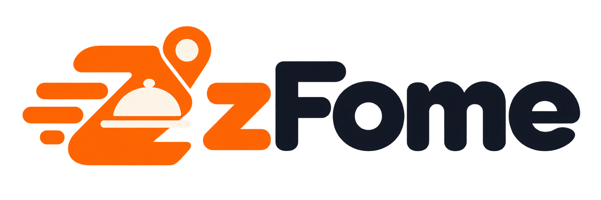
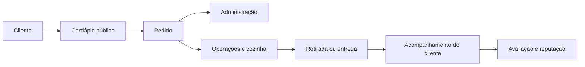
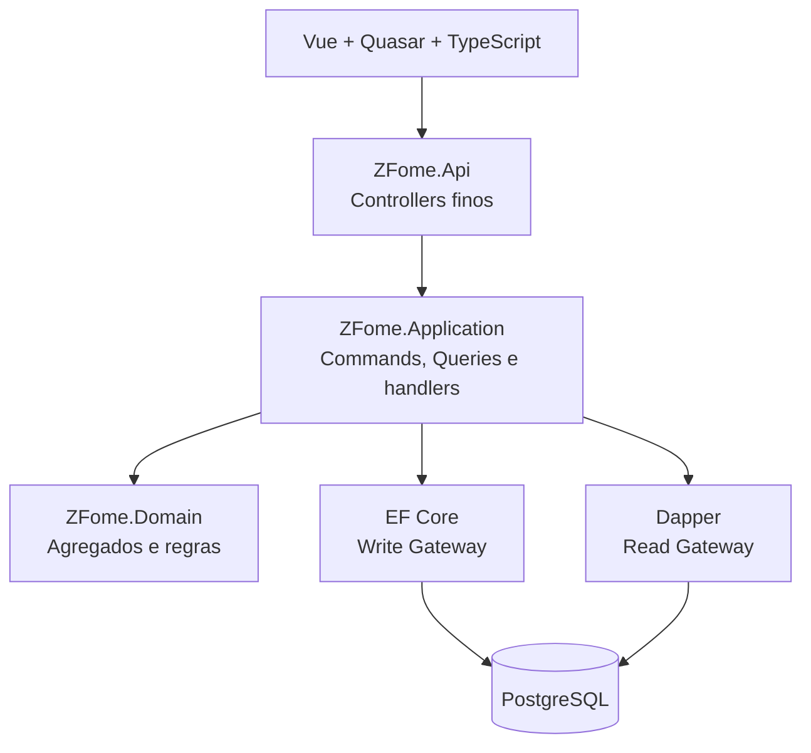

<p align="center">
  
</p>

<p align="center">
  <strong>Seu estabelecimento, seus pedidos, seu ritmo.</strong><br />
  Plataforma SaaS multi-tenant para transformar cardápio, pedidos e operação em um único fluxo.
</p>

<p align="center">
  <a href="#visão-do-produto">Produto</a> ·
  <a href="#arquitetura">Arquitetura</a> ·
  <a href="#executando-localmente">Executar</a> ·
  <a href="#documentação">Documentação</a>
</p>

---

## O que é o zFome?

O zFome é uma plataforma para bares, restaurantes, pizzarias, lanchonetes e outros estabelecimentos de alimentação gerenciarem sua operação digital.

Ele conecta:

- cardápio público e descoberta por cliente;
- criação e acompanhamento de pedidos;
- retirada, entrega e pedidos agendados;
- administração do estabelecimento;
- operação da cozinha e atendimento;
- avaliações e reputação;
- notificações e comunicação;
- configuração multi-tenant com isolamento por estabelecimento.

O projeto está sendo construído como um **monólito modular**, priorizando evolução segura, testes, manutenção e clareza de domínio antes de qualquer extração para serviços independentes.

## Visão do produto



### Superfícies da aplicação

| Superfície | Objetivo |
| --- | --- |
| Public | Descoberta, cardápio, carrinho, checkout e acompanhamento do cliente. |
| Administration | Configuração do estabelecimento, catálogo, disponibilidade, usuários e relatórios. |
| Operations | Acompanhamento rápido de pedidos, preparação, retirada e entrega. |
| KDS | Leitura à distância e execução do trabalho da cozinha. |
| Platform | Provisionamento e contexto institucional da plataforma. |

## Em destaque

- **Cardápio digital** com categorias, produtos, imagens, preços e composição.
- **Pedidos em tempo real** com estados claros para cliente, atendimento e cozinha.
- **Pedidos agendados** com janela de preparo e regras de antecedência.
- **Acompanhamento público** sem exigir autenticação do cliente nesta fase.
- **Avaliações** vinculadas ao pedido, com publicação e moderação previstas no domínio.
- **Multi-tenancy** com isolamento de dados por estabelecimento.
- **Tema claro e escuro** persistido no navegador.
- **Notificações locais** através do Mailpit durante o desenvolvimento.

## Arquitetura

O zFome utiliza .NET 10 no backend e Vue/Quasar no frontend, seguindo Clean Architecture, DDD, CQRS e princípios de arquitetura hexagonal.



### Fluxos de escrita e leitura

```text
Escrita:
HTTP → Controller → CommandDispatcher → Validator → CommandHandler
      → Domain → Write Gateway → EF Core → PostgreSQL

Leitura:
HTTP → Controller → QueryDispatcher → Validator → QueryHandler
      → Read Gateway → Dapper → PostgreSQL → Read Model
```

O domínio permanece independente de HTTP, EF Core, Dapper, PostgreSQL, Docker e Vue. Controllers não acessam banco nem concentram regras de negócio.

## Stack

| Camada | Tecnologias |
| --- | --- |
| Backend | .NET 10, C#, ASP.NET Core |
| Frontend | Vue.js, Quasar, TypeScript |
| Persistência | PostgreSQL, Entity Framework Core, Dapper |
| Execução local | Docker, Docker Compose, Visual Studio |
| Qualidade | Testes unitários, integração e testes de frontend |
| Arquitetura | Modular Monolith, Clean Architecture, DDD, CQRS |

## Executando localmente

### Pré-requisitos

- .NET SDK 10;
- Node.js 22.22 ou superior;
- Docker 29 com Docker Compose;
- Visual Studio ou terminal PowerShell.

### Docker Compose

```powershell
docker compose up --build
```

Serviços padrão:

| Serviço | URL |
| --- | --- |
| Aplicação web | http://localhost:9000 |
| API | http://localhost:8080 |
| Mailpit | http://localhost:8025 |
| SMTP local | localhost:1025 |
| PostgreSQL | localhost:5432 |

O serviço de migrations é executado antes da API. Não é necessário executar `dotnet ef database update` manualmente para o fluxo padrão do Compose.

Para acompanhar o diagnóstico:

```powershell
docker compose ps -a
docker compose logs migrations
docker compose logs api
```

> Se o Visual Studio já estiver executando o projeto, não inicie uma segunda composição usando as mesmas portas. O Visual Studio já cria o stack do Compose, incluindo o Mailpit.

### Backend sem Docker

```powershell
dotnet restore ZFome.sln
dotnet build ZFome.sln --no-restore
dotnet test ZFome.sln --no-build
dotnet run --project src/ZFome.Api
```

### Frontend isolado

```powershell
cd web/ZFome.Web
npm install
npm run dev
```

## Testes e validação

Backend:

```powershell
dotnet test ZFome.sln
```

Frontend:

```powershell
cd web/ZFome.Web
npm run build
npm test
```

Antes de abrir uma mudança, revise também:

- isolamento de tenant;
- validação de entrada com FluentValidation;
- propagação de `CancellationToken`;
- acessibilidade e responsividade;
- contraste nos modos claro e escuro;
- testes arquiteturais e de integração relevantes.

## Estrutura do repositório

```text
src/
├── ZFome.Domain/                 # Modelo, agregados e regras de domínio
├── ZFome.Application/            # Commands, Queries, handlers e portas
├── ZFome.Infrastructure/         # EF Core, Dapper e adapters técnicos
├── ZFome.Infrastructure.Migrations/
├── ZFome.Contracts/              # Contratos externos da API
└── ZFome.Api/                    # Composition root e borda HTTP

web/ZFome.Web/
├── src/components/               # Componentes compartilhados
├── src/layouts/                  # Public, Administration, Operations e Platform
├── src/modules/                  # Features organizadas por domínio
├── src/pages/                    # Páginas de entrada e páginas específicas
├── src/themes/                   # Tokens e preferência de aparência
└── public/brand/                 # Logo e favicon do zFome

openspec/                         # Specs, changes e decisões arquiteturais
docs/                             # Documentação operacional e Design System
```

## Documentação

- [Design System web](docs/web-design-system.md)
- [Notificações de pedidos em tempo real](docs/realtime-order-notifications.md)
- [Arquitetura](openspec/architecture.md)
- [Convenções](openspec/conventions.md)
- [Specs e mudanças OpenSpec](openspec/)
- Cérebro do zFome: `C:\Users\marco\source\repos\Obsidian\Arquiteturando\Projetos\zFome\00 - Home\Home.md` (ambiente local)

O Cérebro do zFome mantém contexto de produto, domínio, fluxos, decisões e histórico. Para requisitos vigentes, prevalecem `AGENTS.md`, OpenSpec, ADRs, Design System e o código atual.

## Próximos passos

- consolidar a experiência de captação e onboarding de estabelecimentos;
- evoluir descoberta de estabelecimentos por CEP;
- ampliar notificações e integrações de comunicação;
- amadurecer autenticação opcional do cliente;
- acompanhar métricas operacionais e de conversão;
- manter a evolução incremental do monólito modular.

## Contribuindo

Antes de alterar o projeto:

1. leia o `AGENTS.md` aplicável;
2. consulte arquitetura, convenções, ADRs e a spec relacionada;
3. pesquise implementações e componentes existentes;
4. implemente a menor mudança coerente;
5. execute build, testes e validações relevantes.

Não adicione MediatR, AutoMapper ou regras de negócio em Controllers. Mudanças arquiteturais exigem ADR antes da implementação.

## Licença

Projeto em desenvolvimento. Consulte os responsáveis pelo repositório antes de redistribuir ou utilizar o software fora do contexto autorizado.
